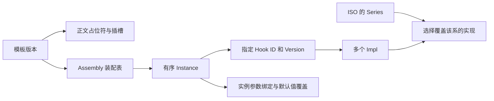
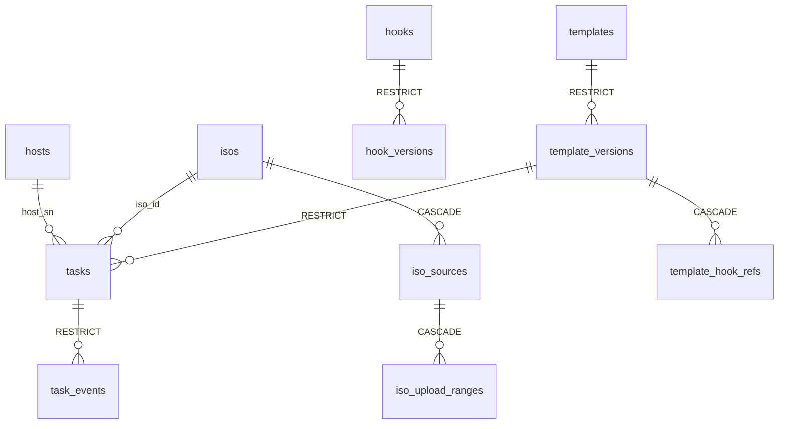
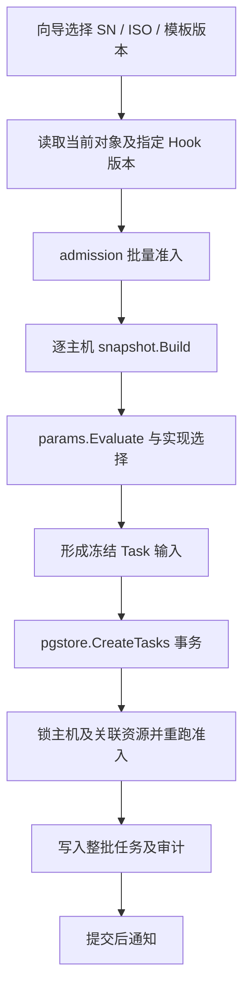

# Lober 数据模型与领域模型调查

调查日期：2026-10-15。以当前工作区代码为准，包含工作区已有修改；设计文档用于解释意图，不能替代实现证据。本次未修改业务代码，未连接业务数据库读取实际数据。

## 1. 主要结论

Lober 当前后端的业务中心是：**把已登记主机、可用 ISO、已审批模板版本组合成装机任务，冻结模板、hook 实现及参数，再由渲染层生成安装文件。**

模型已经分成三个独立表示：

| 表示 | 代码位置 | 职责 |
|---|---|---|
| 领域对象 | `internal/core/model` | 主机、ISO、hook、模板、参数、任务、快照及问题描述 |
| 数据库记录 | `internal/store/pgstore` 的行类型 | GORM 字段、JSONB、主外键、索引、数据库约束 |
| HTTP DTO | `internal/console/*_dto.go` 及处理函数 | HTTP 字段命名、响应形状、领域对象与接口对象的转换 |

核心领域类型没有 GORM tag，也不直接绑定 HTTP JSON 命名。`store.User`、`store.Source` 等支持类型目前放在仓储契约包，不在 `core/model`。

需要优先注意两处现状：**前端仍使用大量旧模型；任务执行状态机尚未接入，取消和重试使用 stub。** 因此不能把当前仓库视为前后端模型完全统一、装机执行闭环已经完成的状态。

证据：[领域类型说明](../../internal/core/model/problem.go)；[数据库行类型说明](../../internal/store/pgstore/rows_registry.go)；[DTO 转换](../../internal/console/authoring_dto.go)。

## 2. 领域概念

### 2.1 目录是静态规则，不是数据库实体

`catalog` 随程序发布，定义 3 个族、14 个系、7 种应答格式，以及格式支持的执行时机、解释器、系统部件、制品角色和架构/固件约束。

- `Family`：linux、windows、esxi。
- `Series`：发行版/安装器分支，例如 Rocky、Ubuntu、SLES 15、SLES 16。
- `Format`：kickstart、preseed、autoinstall、AutoYaST、Agama、unattend、ESXi ks。
- 每个系对应一种格式；格式归属于一个族。版本号是 ISO 的属性。
- 模板可以支持多个系，但这些系必须属于同一族、使用同一格式。

目录没有对应的族/系/格式数据库表。增加支持范围需要修改目录及相应能力实现。

证据：[目录定义](../../internal/core/catalog/series.go:35)；[格式能力](../../internal/core/catalog/timing.go)。

### 2.2 核心实体与组成对象

| 对象 | 身份 | 关键内容与边界 |
|---|---|---|
| `Host` | 规范化 SN | 可选 Arch/Firmware、自定义 Attrs、并发版本 Rev；MAC/IP/机架不是专用身份字段 |
| `ISO` | ID | Family、Series、Version、Arch、State、SHA256、Artifacts、Offers；不引用模板 |
| `Hook` | ID + Version | 参数声明、多个 Impl、默认超时与必需性、审批元信息 |
| `Template` | ID + Version | 正文、支持的系、参数、Bindings、Assembly、派生来源 |
| `Task` | ID | HostSN、ISOID、模板 ID/版本、冻结 Snapshot、状态、创建信息、Rev |
| `Snapshot` | 随任务保存，无独立实体 ID | 冻结的主机、介质、模板正文、插槽、所选 hook 实现正文和最终参数 |

`Impl`、`Instance`、`Binding`、`ParamDecl`、`SnapshotSlot`、`SnapshotValue` 没有独立仓储，作为所属对象的内部组成部分保存。

这里按身份和仓储接口识别出的聚合边界主要是 Host、ISO、Hook、Template、Task。**这是对现有实现的领域分析，不代表代码已经显式采用了完整 DDD 聚合类体系。**

证据：[Host / ISO](../../internal/core/model/registry.go:12)；[Hook / Template](../../internal/core/model/authoring.go:85)；[Task / Snapshot](../../internal/core/model/task.go:56)。

### 2.3 模板与 hook 的装配关系

一个 hook 是组件，不是单个脚本：一个 hook 可以同时具有不同系的实现，其中一些是片段，另一些是脚本。其参数声明由全部实现共用。

- 片段在渲染时写入应答文件。
- 脚本在目标机器的指定时机执行。
- 模板正文声明插槽；`Assembly[插槽名]` 给出有序实例列表。
- 同一 hook 可以实例化多次，每次独立绑定参数，并可覆盖 TimeoutSec、Required。
- 实例固定引用 `(HookID, HookVersion)`，新 hook 版本不会自动替换旧引用。
- hook 的实现不能继续嵌套 hook/插槽。
- `DerivedFrom` 记录派生来源；派生模板是独立内容副本，不是运行时继承。

证据：[装配类型](../../internal/core/model/authoring.go:126)；[模板激活检查](../../internal/core/activation/template.go:29)；[hook 检查](../../internal/core/activation/hook.go:44)。

### 2.4 参数体系

参数声明支持 `word`、`int`、`enum`、`ip`、`cidr`、`hostname`、`diskpath`、`sshkey`、`pwhash`、`text` 十种类型，以及列表、必填、默认值、枚举选项、整数上下限。

`Binding.Source` 只有三种：fixed、attr、default。操作员输入独立保存在求值请求的 `Entered` 中，不是第四种 BindingSource。

求值顺序：根据绑定取预填值 → 根据 Editable 判断是否锁定 → 可编辑时采用操作员非空输入，否则使用预填值 → 按参数类型校验和规范化。

- 没有 Binding 等同于 default 且可编辑。
- enum 选项来自静态 Options 或 ISO.Offers 中的某个集合，两者互斥。
- 模板/片段实际引用的参数必须有值；自由文本只能通过环境变量传给脚本。
- `Value` 封装解析后的规范值，内部字段不导出；落快照时转成 `SnapshotValue{Type,List,Items}`。
- 字段定位统一为 `tpl/<参数名>` 或 `<插槽名>/<实例序号>/<参数名>`，序号从 1 开始。

证据：[参数声明与解析](../../internal/core/model/param.go:24)；[参数求值](../../internal/core/params/params.go:25)。

### 2.5 Version、Rev 与 Schema 含义不同

| 字段 | 含义 | 变化时机 |
|---|---|---|
| Hook/Template `Version` | 被引用的业务内容版本 | 创建新版本时分配；删掉草稿后也不复用旧号 |
| `Rev` | 数据记录的乐观锁修订号 | 更新记录时递增；不是内容版本 |
| `Snapshot.Schema` | 持久化快照格式版本 | 当前为 1，表示快照结构契约 |

Hook/Template 的身份信息和版本信息在数据库中拆开。名称属于身份，改名后读取旧版本也会得到现在的名称；已经冻结的任务仍保留快照中的旧名称。已审批内容修改需要新建版本。

同一个身份可以同时保留多个 approved 版本；“当前已审批版本”是查询规则，不是独立数据库行。`model.CurrentApproved` 对模板选择版本号最高的 approved；最新版本被废弃后会回落到更早的 approved。另一方面，如果选中模板引用的 hook 被废弃，准入会阻止该模板用于新任务，不自动替换 hook 引用。

证据：[版本模型](../../internal/core/model/authoring.go:85)；[身份表与 LastVersion](../../internal/store/pgstore/rows_authoring.go:17)；[快照格式版本](../../internal/core/model/task.go:77)。

## 3. 数据模型：代码定义的 13 张表

数据库实现只有 PostgreSQL，使用 GORM。下面描述的是当前行类型和 schema 断言期望，未查询实际部署库验证结构。

| 表 | 主键 | 主要数据 |
|---|---|---|
| `hosts` | sn | arch、firmware、attrs JSONB、rev |
| `isos` | id | name、family、series、version、arch、state、sha256、artifacts/offers JSONB、rev |
| `iso_sources` | iso_id + role | kind、URL/path、total_size、expected_sha256、fetched、state、error、rev |
| `iso_upload_ranges` | iso_id + role + start | 已持久化上传区间长度 |
| `hooks` | id | name、name_key、builtin、last_version |
| `hook_versions` | hook_id + version | state、author、approver、params/impls JSONB、timeout_sec、required、rev 等 |
| `templates` | id | name、name_key、builtin、last_version |
| `template_versions` | template_id + version | 正文、family、series、params、bindings、assembly、derived_from、state、rev 等 |
| `template_hook_refs` | template_id + template_version + hook_id + hook_version | 模板版本引用的 hook 版本，去重辅助关系 |
| `tasks` | id | host_sn、iso_id、template_id/version、state、snapshot JSONB、created_by/at、rev、last_seq |
| `task_events` | task_id + seq | at、kind、key、fields JSONB |
| `audit_log` | id | actor、action、detail、at、target_kind/id |
| `users` | username | display_name、role、password 散列、disabled、must_change_password、created_at、rev |

说明：`iso_sources.role` 空串代表主介质，非空角色表示附加来源。`taskRow.LastSeq` 是数据库分配事件序号的内部计数，不是领域 `Task` 的字段。

证据：[全部行类型注册](../../internal/store/pgstore/open.go:25)；[表结构期望](../../internal/store/pgstore/schema.go:58)；[用户行](../../internal/store/pgstore/users.go:10)；[来源行](../../internal/store/pgstore/sources.go:15)。

### 3.1 物理外键关系

这张图仅画实际声明的外键。还有三类刻意没有物理外键的关系：

1. `template_hook_refs` 不向 `hook_versions` 建外键：草稿允许临时引用不存在的 hook，批准时再检查。此表主要供删除 hook 草稿时检查引用；准入与审批按模板内容现算引用。
2. `DerivedFrom` 存在 JSONB 中，是来源记录，不是强制继承关系。
3. `audit_log` 的对象标识无外键，对象删除后审计仍能保存；作者/创建者等也不是数据库用户外键。

Hook 正文通过快照保存在任务中，不另建 task-hook 关联表。已批准/废弃的 hook 版本本身不提供删除操作。

证据：[引用表说明](../../internal/store/pgstore/rows_authoring.go:94)；[约束及删除动作](../../internal/store/pgstore/schema.go:138)；[审计行](../../internal/store/pgstore/rows_audit.go:5)。

### 3.2 关系列与 JSONB 的分工

主键、状态、名字、任务关联、修订号、时间放普通列，供索引、查询和外键使用。参数、实现、装配表和快照放 JSONB，保留对象内部结构。

它体现的是“关系表管理身份与生命周期，JSONB 保存聚合内容”的选择。好处是结构与领域对象接近；代价是嵌套字段规则主要靠应用层保障，复杂 JSONB 数据迁移需要另外设计。

持久化 JSON 使用 Go 领域字段名，HTTP DTO 使用显式 JSON 字段名，不能假定两者完全相同。持久化一般保留 nil 与空集合的区别；HTTP 转换通常将集合输出为 `[]` / `{}`。

启动流程是 `AutoMigrate` 后执行 schema 断言，比对主键、索引、外键和 CHECK。已有同名约束定义不正确时会拒绝启动，并给出人工修复提示。它提供结构漂移检测，但当前代码不是按编号迁移脚本管理 schema 演进。

证据：[JSON 编解码](../../internal/store/pgstore/rows_registry.go)；[启动建表与断言](../../internal/store/pgstore/open.go:54)；[结构断言实现](../../internal/store/pgstore/schema.go)。

## 4. 规则在哪里执行

| 模块 | 责任 |
|---|---|
| `catalog` | 平台、格式、时机等静态能力事实 |
| `model` | 类型、局部合法性、规范化、结构化问题 |
| `scan` | 扫描正文中的系统部件、系统值、插槽、参数引用 |
| `activation` | Hook/Template 批准前的完备性、装配及引用检查；作者不能自批 |
| `params` | 生成参数表单、解析绑定和操作员输入、得到规范值 |
| `admission` | Host + ISO + Template 是否能组合建任务 |
| `snapshot` | 选择实现并复制内容、固定最终参数、形成快照 |
| `store` | 仓储接口、输入检查、审计/事件/分页契约 |
| `pgstore` | 事务、加锁、Rev 比对、索引约束、数据库读写 |
| `console` | HTTP、鉴权、向导编排、DTO、提交后通知 |
| `render` | 用快照和本次调用输入生成文件，不自行查询数据库 |

因此更适合描述为“纯领域对象 + 纯函数领域服务 + 仓储”的架构。复杂规则不全塞在实体方法中，也没有只依靠数据库 CRUD。

### 4.1 建任务的实际链路

有一处重要边界：快照由 console 在仓储事务前构建；仓储事务重跑的是准入判定，不会重新求参数或重建快照。调查不能据此宣称“所有快照字段都是在同一个数据库事务中读取并冻结”。如果未来要求严格的单一时点一致性，需要单独评估这条边界。

证据：[向导提交](../../internal/console/wizard.go:405)；[事务建任务](../../internal/store/pgstore/tasks.go:37)；[快照构建](../../internal/core/snapshot/build.go:41)。

### 4.2 并发、审计与事件

- `Rev` 处理记录并发更新；任务推进同时比较期望 `State + Rev`。
- 部分唯一索引保证一台主机最多一个未结束任务。
- ISO 按非空 SHA256 去重，failed 状态不占用去重唯一性。
- Hook/Template 各自使用名称 key 唯一索引，并且每个身份最多一个 draft/review 版本。
- 一批建任务在一个事务中完成，任一失败整批回滚；需要审计的动作与审计同事务。
- 状态与伴随事件可以同事务提交。
- 事件只追加，每任务 Seq 从 1 连续分配；非空 Key 按 task_id + key 去重。
- 单独追加事件不改变 Task.Rev；数据库 LastSeq 单独递增。
- 仓储事务固定 READ COMMITTED；调用方提供审计/创建时间，仓储不读取时钟。

这些事件是任务日志/信号记录：任务当前状态与快照直接保存在 tasks 表，没有实现从事件重放所有聚合的事件溯源机制。

证据：[仓储契约](../../internal/store/store.go:151)；[事件写入](../../internal/store/pgstore/events.go)；[任务条件推进](../../internal/store/pgstore/tasks.go)；[事务隔离级别](../../internal/store/pgstore/open.go)。

## 5. 状态与当前实现边界

Hook/Template 版本生命周期：`draft → review → approved → deprecated`，允许 `review → draft` 驳回。已审批/废弃内容不能直接修改或删除；草稿可保存、删除。内置内容只读且出厂已审批。

ISO 状态取值：`acquiring`、`importing`、`ready`、`failed`、`deprecated`。只有 ready 且记录合法的 ISO 能用于新任务；废弃不影响旧任务。

Source 状态取值：`pending`、`fetching`、`fetched`、`failed`、`cancelled`。来源状态和 ISO 导入状态是两套生命周期，获取完成不等于 ISO 已经可用。

Task 定义的正常阶段是 `pending → booting → installing → rebooting → initializing → done`，另有 failed/cancelled 终态。**当前仓储只检查目标状态合法性与并发条件，不负责判断某条业务迁移能否发生。** Task 模型与注释将执行状态机、token、引导次数等责任留给第 7 层。

当前装配点明确传入 `taskControlStub{}`，Cancel/Retry 返回 `ErrTaskControlUnavailable`。所以状态取值已定义、条件推进已实现，不能等同于执行状态机已实现。

证据：[状态定义](../../internal/core/model/task.go:12)；[任务控制占位](../../cmd/lober/taskcontrol.go:10)；[实际装配](../../cmd/lober/app.go:99)。

## 6. 前后端模型差异

以下是已确认的源码契约差异，未做浏览器端联调：

| 对象 | 当前后端 | 当前前端 API 类型 |
|---|---|---|
| Host | SN 身份、Attrs、Rev，平台字段可空 | id/sn/mac/uuid/rack/lastSeenAt 等旧固定字段 |
| Template | Family/Series、Body、Params、Bindings、Assembly，approved 状态 | artifactSetId、diskPolicy、answerTemplate、hookRefs，active 状态 |
| Hook | 多个 Impls、统一 Params、approved 状态 | 单 body/interpreter/stage、paramsSchema、requires，active 状态 |
| Task | isoID、hostSN、snapshot、rev、cancelled | artifactSetId、hostSn/hostMac/hostUuid、phase/failure/attempt 等旧字段；状态缺 cancelled |
| 主机列表 | `{items,next}` 游标分页，prefix/attr 过滤 | 预期数组，offset/q 过滤 |
| 建任务 | wizard 提交批量主机、ISO 和模板选择 | 旧 POST /tasks，hostId + templateId + formData |

这说明 `web/` 的 API 类型和注释不宜作为当前后端领域模型的事实来源。后续对接应以现有 console DTO/路由为基准，成组更新类型、表单、页面及调用流程，而不是只改字段大小写。

证据：[前端 Host](../../web/apps/web-ele/src/api/console/host.ts:19)；[前端 Template](../../web/apps/web-ele/src/api/console/template.ts:33)；[前端 Hook](../../web/apps/web-ele/src/api/console/hook.ts:22)；[前端 Task](../../web/apps/web-ele/src/api/console/task.ts:18)；[后端 Host DTO](../../internal/console/hosts.go:14)；[后端 Task DTO](../../internal/console/task_dto.go:71)。

## 7. 后续优先级建议

1. **统一前后端契约。** 以当前 HTTP DTO/路由为依据，先对齐 Host、ISO、Template、Hook、Task、向导及分页，清理旧 ArtifactSet/MAC 双因子概念。
2. **补齐执行领域。** 明确合法状态迁移、取消/重试规则、超时预算、token 与执行进度的持久化位置，再替换 taskControlStub。
3. **约定快照一致性。** 确认“构建时读到的登记内容”是否满足需求，还是要求与事务内最新主机登记完全一致。
4. **规划 schema / 快照演进。** 已有快照 Schema 和结构断言，但长期数据的版本升级、历史 JSON 兼容和部署迁移仍需明确方案。

会话目前保存在 console 的内存 map，不在 13 张表内。如果未来要求多实例或重启保留登录，需要另行考虑会话存储。这是现有行为和扩展条件，不是本次已经验证的运行故障。

## 8. 核验范围

本次核验读取了核心类型、规则函数、仓储契约、全部数据库行类型与 schema 期望、console DTO/向导、装配点，以及前端 API 类型。没有执行真实装机或前后端联调，没有检查部署数据库中的实际数据。

执行 `go test -count=1 ./internal/core/... ./internal/store ./internal/archtest`，退出码 0：7 个 core 包、store 和 archtest 共 9 个包全部通过；架构测试耗时约 100 秒。

本次未运行 `internal/store/pgstore` 的数据库契约测试；数据库结构与约束结论来自行类型、schema 期望及相关实现的静态核对，不能据此断言实际部署库已经符合预期。
