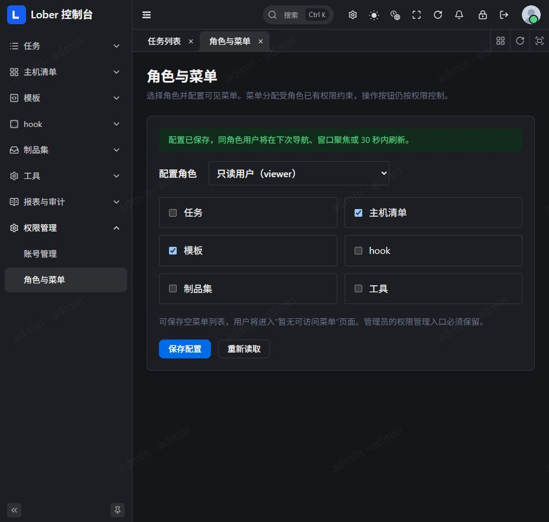
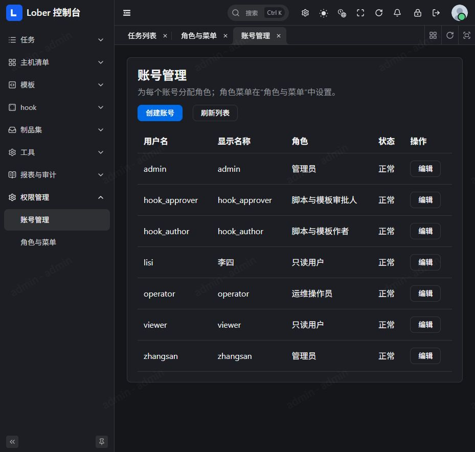
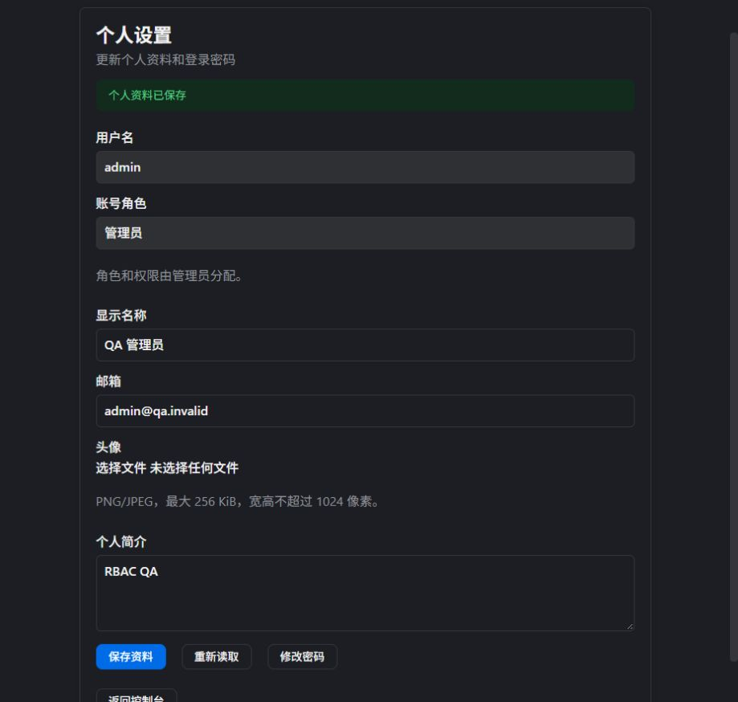
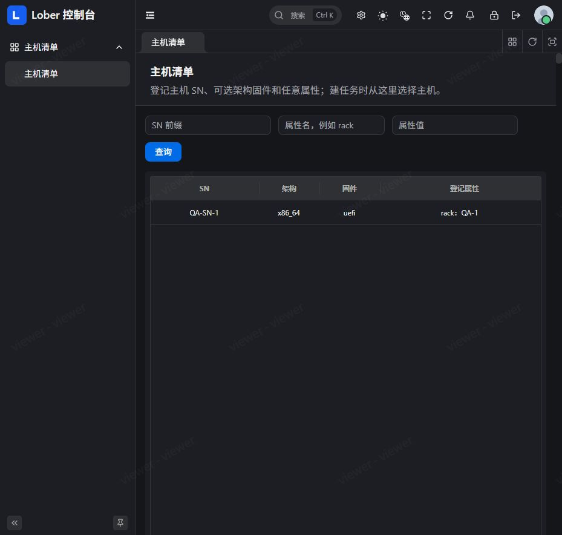
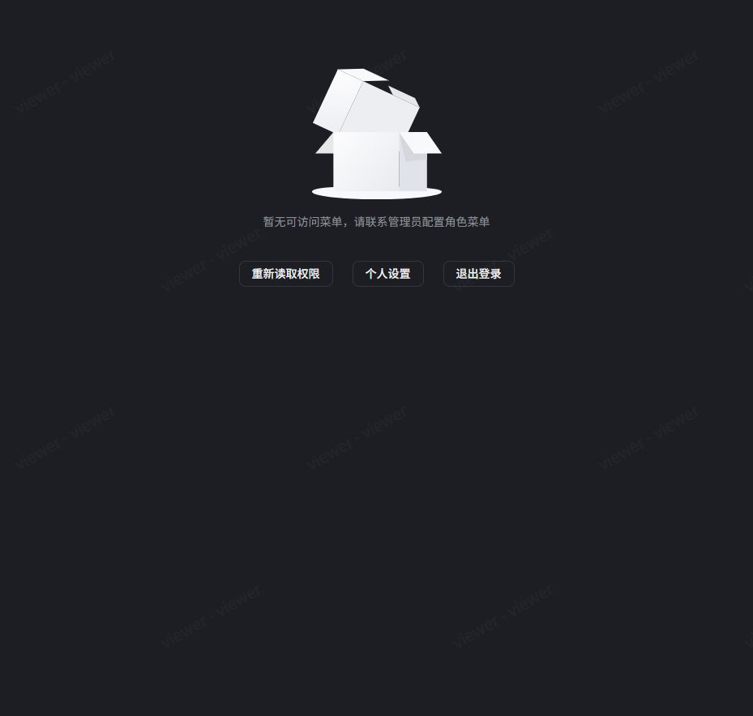
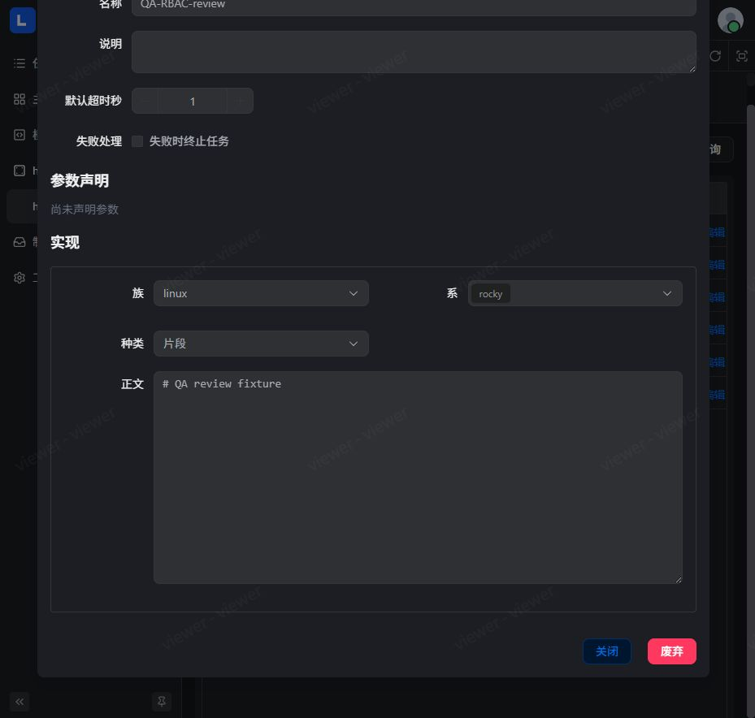

# RBAC、角色菜单及个人设置验收（2026-10-17）

目标分支 `dev`，功能分支 `codex/rbac-menu`。先吸收 `dev` 的 `9313f85` 第六层验收结果，再实现并验证本次功能；保留原工作区的未提交改动。本文记录功能、证据和取舍，合入结果见末尾。

## 交付内容

- 后端继续采用五个固定角色和十六项操作权限；认证用户的权限与当前角色保持一致。只有 admin 可以管理账号、分配角色和编辑角色菜单。
- 权限管理 → 账号管理（`/access/users`）：创建账号、分配角色、编辑显示名、重置密码、禁用/启用。保留最后管理员及本人禁用保护。
- 权限管理 → 角色与菜单（`/access/role-menus`）：为指定角色配置可见菜单，保存空列表表示无业务菜单；admin 必留权限管理入口。菜单配置不增加 API 操作权限。
- 个人设置（`/account/profile`）：各账号修改本人的显示名、邮箱、PNG/JPEG 头像、简介；用户名和角色只读。空菜单账号仍可进入个人设置和退出。
- 修复 token/accessToken、role/roles、缺失 auth/codes、带认证登出、首次改密、改密会话撤销及前端权限入口。当前用户变化会清理旧路由、标签及缓存，并在导航、聚焦和 30 秒检查时更新。
- 保留 dev 已验收的主机 CSV、ISO 分片续传、完整模板/脚本编辑器、服务端预览和 Go 内嵌前端；移除本轮与其重复的中间实现。

## 验证结果

| 验证 | 结果 |
| --- | --- |
| VM Go 格式检查、`go vet ./...` | 通过 |
| VM `go test -count=1 ./...`（含真实 PostgreSQL） | 通过 |
| VM `go test -race -timeout=20m ./...` | 通过 |
| Linux amd64 二进制构建、Wire fallback 漂移检查 | 通过 |
| 前端 lockfile 安装、OpenAPI 类型漂移检查 | 通过 |
| Vue 类型检查、console ESLint | 通过 |
| 前端 Vitest，修复审查问题后 | 25 文件、88 项通过 |
| 生产前端构建 | 通过，制品嵌入 VM 二进制 |
| 五角色真实 HTTP：个人资料、admin 专属管理、字段注入、角色分配、禁用/启用、菜单 CAS、viewer 禁写、登出撤销 | 通过 |
| 重启后个人资料、账号角色、菜单保持，旧会话拒绝 | 通过 |
| iPXE 从 TFTP 下载回读 | 与上传文件逐字节一致 |

测试 VM：Ubuntu 24.04，Go 1.27.2，Node 24.22.0，PostgreSQL。Go 检查设置 `GOMAXPROCS=2`、`GOFLAGS=-p=2`、`GOMEMLIMIT=3GiB`，未发生 OOM。前端依赖使用 pnpm 11.16.0。完整后端日志保存在 VM 的 `/home/dev/lober-rbac-test/current/logs/`。

远端初次重建 Git 索引时，忽略规则使占位 embed 文件未被加入架构测试夹具，导致其临时拷贝无法编译。显式加入原仓库已跟踪的两个占位文件后，架构测试及完整检查重新通过；该失败不是通过跳过测试处理。

## 独立审查及修复

独立只读审查范围 `9313f85..73ec7df`，没有审查者修改或第二轮重复审查。发现一项 Critical、两项 Important，无遗留 Minor。作者逐项复现并在一个修复批次中处理，提交 `43ab242`：

1. 个人资料慢请求可给旧认证快照换上猜测的新 rev，回写管理员刚重置的密码、角色或禁用状态。新增受控请求体门测试，三个场景均先返回错误的 200；修复后保留认证快照 rev 并先核对请求 rev，三个场景均拒绝，安全字段保持新值。
2. 菜单撤销后的重定向读取失败，后续刷新被 `changed=false` 短路。真实 Router 测试先复现撤销页面持续停留；修复后每次核对当前位置和匹配记录，恢复网络后能够离开撤销页面。
3. 空菜单恢复时仍停留空权限页。真实 Router 测试先复现；修复后仅在仍无可用首页时保留空页，恢复菜单后跳转首页。

上述测试均实际观察 RED→GREEN，随后运行全量前端及 VM Go/race 检查；未将原始审查的“No”结论表述为重新审查通过。

## 浏览器证据

实际连接 VM 的生产二进制进行验证，未注入浏览器存储或伪造页面数据：

- admin 登录、角色菜单勾选和保存成功；账号页显示 `zhangsan → admin`、`lisi → viewer` 等测试账号。
- 本人资料保存成功，安全字段只读；服务重启后资料保持并要求重新登录。
- viewer 仅配置 hosts 时只显示主机菜单，无主机写入及 CSV 导入按钮；直接访问 templates 不能显示模板页面。
- 完整重载新版后，再次清空菜单，停留页面自动进入空权限页；恢复 hosts 后自动返回主机首页，验证审查发现的恢复问题已修复。
- 将同一已登录测试账号分配为 operator，任务页显示批量建任务；分配为 hook-author，hook 页显示新建入口。独立 HTTP 登录仍覆盖五个角色。
- 分配为 hook-approver 后，新建入口消失、正文只读；在真实页面批准另一账号提交的测试版本，状态变为 approved、审批人及 rev 正确更新。验收后恢复 viewer。

服务升级后曾保留着旧 SPA 的内存脚本，完整重载后重新验证修复版本；未把旧页面的结果冒充新版本验收。

## 测试部署

- 控制台：`http://192.168.137.21:18080/`。
- 程序和源码：`/home/dev/lober-rbac-test/current/`；应用使用独立测试 schema，不操作生产数据。
- 测试账号及启动说明保存在 VM 的 `/home/dev/lober-rbac-test/current/QA-ACCOUNTS.txt`，权限为 600；口令不提交到 Git。
- iPXE：`/srv/tftp/ipxe.efi`、`snponly.efi`、`undionly.kpxe`；另保留 `/srv/tftp/lober-rbac/` 的测试副本。保留已有 DHCP、Nginx 和 TFTP 服务配置。
- 前端生产制品先构建，再嵌入 Go；本地输出为 `internal/console/ui/dist/`，Git 保留原有最小占位文件，真实制品作为测试发布包交付。

## 执行取舍及代价

以下覆盖执行账本中的全部 Ruling，包括后来被 dev 集成取代的中间决策：

1. 原生 worktree 工具配置的 Git 路径缺失，改用已安装 Git 创建隔离工作区。代价：工作区不由应用自动管理；原工作区改动保留。
2. 技能 shell 辅助脚本为 CRLF，复制到忽略目录转为 LF 后运行。代价：辅助工具路径不同，行为不变。
3. 领域标识符不允许 `role-menus` 的连字符，菜单存储采用同样有界的标识符规则并允许连字符。代价：菜单 ID 语法略宽；目录仍限制可分配 ID。
4. 本地原生渲染测试缺少 Bash/BusyBox 环境变量，设置已有二进制路径。代价：验证依赖这些原生工具，不改变产品行为。
5. 上游认证拦截器无法辨认失败请求使用的 token，增加应用自己的会话响应边界。代价：维护专门的旧响应/旧 401 回归。
6. 初期旧业务页面使用废弃契约，曾替换为当前契约的集中实现。随后吸收 dev 的已验收页面并删除重复实现。代价：中间提交的页面实现被替换；最终保留 dev 原有业务功能。
7. 个人资料采用显示名、联系邮箱、本地 PNG/JPEG 头像和简介；用户名、安全字段只读，账号页复用必留管理菜单。代价：邮箱认证、自定义角色或多角色分配需要另加流程。
8. 合并 dev 的第六层实现，保留 CSV、续传、编辑器和 embed，旧 `/users`、`/audit` 作为隐藏别名。代价：需要合并后完整回归；保留部分兼容源码。
9. 审查者未判定最终远端和浏览器结果，作者以单独的实际日志和界面证据完成验收。代价：不能把代码审查本身当作环境验证。
10. 未连接生产存量库，以真实 PostgreSQL 临时 schema、重开、CAS 和审计回滚覆盖持久化。代价：特定生产数据及手工 DDL 的实际升级仍需在对应部署环境核实。
11. 浏览器以 admin/viewer 登录及同一会话依次重新分配角色验证五角色入口变化；独立会话隔离由五账号 HTTP 及延迟响应单测覆盖。代价：未在多个独立浏览器 profile 中重复整套流程。
12. 浏览器工具要求新密码录入由用户接管，因此以真实 HTTP 改密和真实组件测试验证提交、强制改密及撤销会话；浏览器验证强制页面及重新登录。代价：未通过浏览器提交新密码。

## Deferred minors

浏览器验收发现 dev 既有的一项轻微显示问题：hook 审批成功后，当前详情标题、状态、权限和审批人正确更新，但版本下拉中的状态标签仍为旧值，重新打开详情后刷新。保留此显示问题供后续处理；独立代码审查本身未列出 Minor。

## 现有边界

角色及其操作权限固定；本次添加的是账号角色分配与角色菜单配置。邮箱仅为联系资料。独立报表统计、磁盘 dry-run 和第七层真实装机任务控制尚未实现；本次不是实体机装机验收。

## 合入结果

代码、构建、测试及最终浏览器验收已通过，按用户授权准备本地合入 `dev`。
